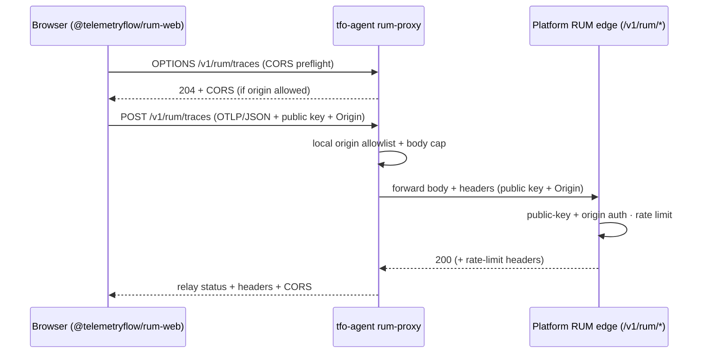

# RUM Ingestion Edge (`tfo-agent rum-proxy`)

> Run a local **Real User Monitoring** edge: browsers beacon web telemetry to a
> nearby agent, which forwards it to the TelemetryFlow platform. Available since
> **v1.3.7**.

## What it is

The browser SDK [`@telemetryflow/rum-web`](https://docs.telemetryflow.id) batches
page views, route changes and web vitals (LCP, INP, CLS, FCP, TTFB) and beacons
them as **OTLP/JSON** to the platform RUM edge (`/v1/rum/traces`,
`/v1/rum/metrics`), authenticated by a **public app key** with an **origin
allowlist**.

`tfo-agent rum-proxy` exposes those same routes locally and **transparently
forwards** each beacon to the platform. This lets you:

- Point browsers at a nearby agent (lower latency, fewer cross-region hops).
- Centralize the RUM endpoint behind your own infrastructure.
- Keep RUM working when the platform isn't directly reachable from the browser.

The agent is a **pass-through**: it does not inspect or alter the beacon. The
platform remains the authoritative authority for the **public key**, the
**origin allowlist**, bot filtering and per-app rate limits. The agent adds a
**local origin allowlist** (defense-in-depth), **CORS** handling, a **2 MiB body
cap**, and strips hop-by-hop headers.

## Quick start

```bash
tfo-agent rum-proxy \
  --listen :8319 \
  --upstream https://ingest.telemetryflow.id \
  --allow-origin https://app.example.com \
  --allow-origin https://www.example.com
```

Then point the browser SDK at the agent instead of the platform:

```js
import { tfoRum } from '@telemetryflow/rum-web';

tfoRum.init({
  key: 'rum_pub_…',                     // your RUM public app key (unchanged)
  endpoint: 'https://rum-edge.internal:8319', // the agent, not the platform
});
```

## Flags

| Flag | Default | Purpose |
|------|---------|---------|
| `--listen` | `:8319` | Address to accept browser beacons on |
| `--upstream` | agent config `backend_endpoint` | Platform RUM edge base URL |
| `--allow-origin` | — (**required**, repeatable) | Allowed browser origin; `*` allows any |

If `--upstream` is omitted, the agent falls back to the loaded config's
`telemetryflow.backend_endpoint`. At least one `--allow-origin` is required
(pass `--allow-origin '*'` to allow any origin — not recommended in production).

## How a beacon flows



## Security

- **Auth is end-to-end.** The agent never holds the RUM public key; it forwards
  the browser's credentials to the platform, which authenticates them. A beacon
  from a disallowed origin is rejected **twice** (agent allowlist, then platform).
- **No SSRF.** The upstream is operator-configured, never derived from the
  request.
- **CORS** is scoped to `--allow-origin` (wildcard only when you pass `*`).
- Run the edge behind TLS (a reverse proxy or a TLS-terminating load balancer)
  so browser beacons are encrypted in transit.

## See also

- [COMMANDS.md](./COMMANDS.md) — all `tfo-agent` subcommands.
- [TFO-PLATFORM-INTEGRATION.md](./TFO-PLATFORM-INTEGRATION.md) — platform endpoint
  + keys.
- Platform guide: `docs/getting-started/rum-web-sdk.md` (browser SDK setup) and
  `RUM_INGESTION_ENABLED` on the platform.
